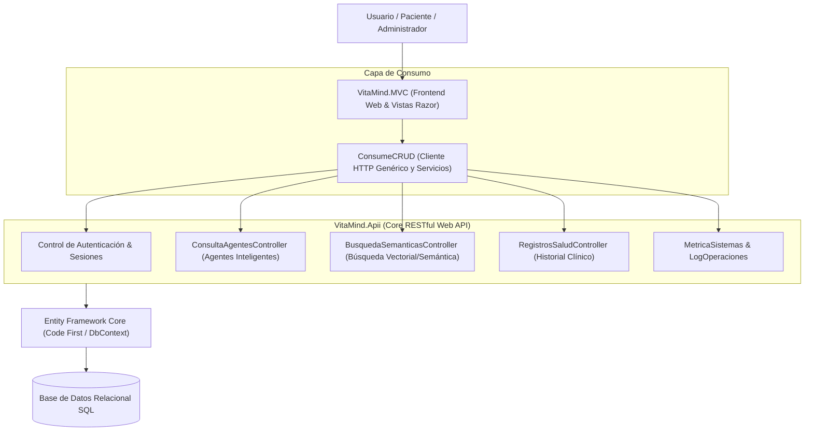

<div align="center">

# 🧠 VitaMind — Plataforma de Salud Mental & Bienestar con IA

[](https://dotnet.microsoft.com/)
[](https://learn.microsoft.com/dotnet/csharp/)
[](https://dotnet.microsoft.com/apps/aspnet)
[](https://learn.microsoft.com/ef/core/)
[](#)

<p align="center">
  Sistema integral de asistencia clínica y seguimiento de bienestar emocional que combina arquitectura desacoplada en .NET, consultas asistidas por agentes inteligentes, búsqueda semántica en registros y chatbot interactivo para usuarios.
</p>

</div>

---

## 📌 Tabla de Contenidos
- [Descripción General](#-descripción-general)
- [Arquitectura de la Solución](#-arquitectura-de-la-solución)
- [Módulos Principales](#-módulos-principales)
- [Stack Tecnológico](#-stack-tecnológico)
- [Estructura del Proyecto](#-estructura-del-proyecto)
- [Instalación y Puesta en Marcha](#-instalación-y-puesta-en-marcha)
- [Autor](#-autor)

---

## 💡 Descripción General

**VitaMind** nace como respuesta a la necesidad de acompañamiento y monitoreo continuo del bienestar emocional y la salud mental. La plataforma permite a los usuarios registrar sus estados de ánimo, síntomas y hábitos diarios, a la vez que interactúan con un **chatbot interactivo** y realizan **búsquedas semánticas** inteligentes sobre recursos clínicos, diagnósticos preliminares y recomendaciones personalizadas.

Para el personal administrativo y especialistas, ofrece paneles de control con métricas operativas del sistema, trazabilidad de logs y seguimiento evolutivo del paciente.

---

## 🏗️ Arquitectura de la Solución

El proyecto sigue una arquitectura desacoplada orientada a servicios dividida en:



---

## 🚀 Módulos Principales

### 1. 🤖 Agentes Inteligentes y Chatbot de Asistencia
- **Chatbot interactivo:** Asistente conversacional accesible desde el portal del usuario para evaluación de estado anímico y orientación preventiva.
- **Agentes de Consulta (`ConsultaAgentesController`):** Procesamiento de solicitudes estructuradas orientadas a la inferencia y análisis de patrones en el comportamiento del usuario.

### 2. 🔍 Búsqueda Semántica (`BusquedaSemanticasController`)
- Motor de indexación y búsqueda basado en el significado contextual de los registros, superando la búsqueda tradicional por palabras clave.

### 3. 📊 Registros de Salud & Telemetría
- Historial clínico digital con seguimiento cronológico de variables fisiológicas y emocionales.
- Alertas preventivas ante variaciones drásticas en los indicadores de bienestar.

### 4. 🛡️ Auditoría, Métricas y Administración
- **Dashboard analítico:** Visualización del tráfico, usuarios activos y distribución de consultas.
- **Logs de Operaciones & Errores:** Monitoreo activo de excepciones (`ErrorIngresosController`, `LogOperacionesController`).
- **Control de Roles:** Perfiles diferenciados para Cliente, Terapeuta y Administrador.

---

## 🛠️ Stack Tecnológico

- **Lenguaje:** C# 12 (.NET 8.0 SDK)
- **Framework Web:** ASP.NET Core MVC (Vistas Razor, ViewModels, Controladores)
- **API REST:** ASP.NET Core Web API con documentación Swagger/OpenAPI
- **ORM:** Entity Framework Core con soporte para migraciones
- **Cliente HTTP:** `IHttpClientFactory` y biblioteca de consumo modular `ConsumeCRUD`
- **Frontend:** Bootstrap 5, JavaScript interactivo, CSS3 moderno

---

## 📁 Estructura del Proyecto

```plaintext
VitaMind/
├── VitaMind.slnx                 # Solución principal de Visual Studio
├── VitaMind.Apii/                # Web API Core con controladores REST e IA
│   ├── Controllers/              # Búsqueda semántica, agentes, métricas, salud
│   ├── Data/                     # AppDbContext y configuración de EF
│   └── Program.cs                # Inyección de dependencias y middlewares
├── VitaMind.MVC/                 # Aplicación web de presentación
│   ├── Controllers/              # Chatbot, Dashboard, Admin, Auth, Registros
│   ├── Views/                    # Interfaz de usuario (Razor)
│   └── wwwroot/                  # Estilos, scripts y assets estáticos
└── ConsumeCRUD/                  # Módulo de integración HTTP y servicios CRUD
```

---

## ⚙️ Instalación y Puesta en Marcha

### Prerrequisitos
- [.NET 8.0 SDK](https://dotnet.microsoft.com/download/dotnet/8.0)
- [Visual Studio 2022](https://visualstudio.microsoft.com/) o VS Code con extensión C# Dev Kit
- SQL Server LocalDB o instancia de base de datos relacional

### Pasos

1. **Clonar el repositorio:**
   ```bash
   git clone https://github.com/JonathanC0409/VitaMind.git
   cd VitaMind
   ```

2. **Configurar la cadena de conexión:**
   Revisa los archivos `appsettings.json` en `VitaMind.Apii` y `VitaMind.MVC` para apuntar a tu base de datos local.

3. **Restaurar paquetes y compilar:**
   ```bash
   dotnet restore
   dotnet build
   ```

4. **Ejecutar la API y la aplicación web:**
   ```bash
   # Terminal 1: Iniciar Web API
   dotnet run --project VitaMind.Apii

   # Terminal 2: Iniciar Web MVC
   dotnet run --project VitaMind.MVC
   ```

---

## 👨‍💻 Autor

**Jonathan Cepeda**  
- GitHub: [@JonathanC0409](https://github.com/JonathanC0409)  
- Correo: [jjcepedaa@utn.edu.ec](mailto:jjcepedaa@utn.edu.ec)